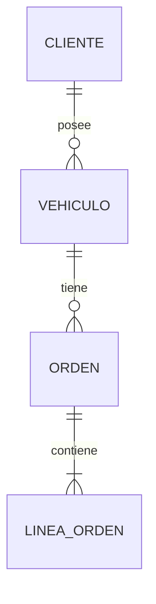

# UD07 · Documentación de aplicaciones y sistemas de ayuda

| Módulo | Curso | Duración orientativa | RA trabajados |
|---|---|---|---|
| MP0488 Desarrollo de interfaces · Bloque MP0488_22 Despliegue de aplicaciones | 2.º DAM | 15 h · ≈ 18 sesiones de 50 min (estimación; semanas 25–27) | RA6 (a–g, principal) · RA3.f (refuerzo) |

> Tecnología: Markdown + `mkdocs.yml` (MkDocs Material o Zensical). Justificación y riesgos de vigencia en [DEC-DI-05](../../decisiones/DEC-DI-05-documentacion-y-ayuda.md).

## Criterios de evaluación

| CE | Texto literal | Fuente | Cómo se evalúa |
|---|---|---|---|
| RA6.a | Se han identificado sistemas de generación de ayudas. | [RD 405/2023, anexo I, 0488, RA6.a](https://www.boe.es/diario_boe/txt.php?id=BOE-A-2023-13221) | Cuestionario en aula; P7 (justificación de la herramienta) |
| RA6.b | Se han generado ayudas en los formatos habituales. | [RD 405/2023, anexo I, 0488, RA6.b](https://www.boe.es/diario_boe/txt.php?id=BOE-A-2023-13221) | P7: sitio HTML con índice y búsqueda, más PDF |
| RA6.c | Se han generado ayudas sensibles al contexto. | [RD 405/2023, anexo I, 0488, RA6.c](https://www.boe.es/diario_boe/txt.php?id=BOE-A-2023-13221) | P7: F1 abre la sección de la pantalla activa; *tooltips* y ayuda en línea |
| RA6.d | Se ha documentado la estructura de la información persistente. | [RD 405/2023, anexo I, 0488, RA6.d](https://www.boe.es/diario_boe/txt.php?id=BOE-A-2023-13221) | P7: diagrama ER, diccionario de datos y ubicación y copia de seguridad de los datos |
| RA6.e | Se ha confeccionado el manual de usuario y la guía de referencia. | [RD 405/2023, anexo I, 0488, RA6.e](https://www.boe.es/diario_boe/txt.php?id=BOE-A-2023-13221) | P7 |
| RA6.f | Se han confeccionado los manuales de instalación, configuración y administración. | [RD 405/2023, anexo I, 0488, RA6.f](https://www.boe.es/diario_boe/txt.php?id=BOE-A-2023-13221) | P7. Se completa en UD08 con los parámetros del instalador |
| RA6.g | Se han confeccionado tutoriales. | [RD 405/2023, anexo I, 0488, RA6.g](https://www.boe.es/diario_boe/txt.php?id=BOE-A-2023-13221) | P7: vídeo tutorial subtitulado y guía paso a paso |

## Contenidos básicos del currículo

> **[Normativo]** Bloque «Documentación de aplicaciones», texto literal. Fuente: [RD 405/2023, anexo I, módulo 0488, contenidos básicos](https://www.boe.es/diario_boe/txt.php?id=BOE-A-2023-13221).

- Ficheros de ayuda. Formatos.
- Herramientas de generación de ayudas.
- Tablas de contenidos, índices, sistemas de búsqueda, entre otros.
- Tipos de manuales: Manual de usuario, guía de referencia, guías rápidas, manuales de instalación, configuración y administración. Preguntas más frecuentes. Destinatarios y estructura.
- Elaboración de tutoriales.

## Objetivos de aprendizaje

> **[Propuesta del docente]**

Al terminar la unidad el alumnado será capaz de:

1. Comparar formatos y herramientas de ayuda, tanto actuales como históricos.
2. Construir un sitio de ayuda con tabla de contenidos, búsqueda, glosario y FAQ, y exportarlo también a PDF.
3. Implementar ayuda sensible al contexto en una aplicación JavaFX.
4. Documentar el modelo de datos y su ciclo de vida (ubicación, copias, migraciones).
5. Redactar los distintos manuales según su destinatario.
6. Producir un tutorial en vídeo accesible.

## Contenidos desarrollados

> **[Propuesta del docente]**

### 1. Sistemas y formatos de ayuda (RA6.a, b)

| Formato | Características | Vigencia |
|---|---|---|
| **HTML estático** (sitio de documentación) | Navegable, con búsqueda, enlaces profundos (anclas) y accesible. Se puede incluir con la aplicación o publicar en la web | Formato actual de referencia |
| **PDF** | Para imprimir o archivar. No sirve para la ayuda contextual | Complementario |
| **Ayuda integrada en la interfaz** | *Tooltips*, `promptText`, textos de ayuda junto al campo, estados vacíos con instrucciones, recorridos de bienvenida | Imprescindible |
| **CHM** (Microsoft HTML Help) | HTML compilado con índice y búsqueda, solo para Windows | Heredado |
| **JavaHelp** | Sistema de ayuda de Swing | Obsoleto |
| **Base de conocimiento o FAQ en línea** | Actualizable sin reinstalar | Habitual en productos SaaS |

| Herramienta | Tipo | Salida |
|---|---|---|
| MkDocs (+ Material) / Zensical | Generador estático desde Markdown | HTML con búsqueda |
| Docusaurus, Sphinx | Generadores estáticos | HTML (y PDF) |
| HelpNDoc | Autoría de ayudas de escritorio | CHM, HTML, PDF, ePub |
| JavaDoc | Documentación de API para quien programa (no es ayuda al usuario) | HTML |
| Pandoc | Conversión entre formatos | PDF, DOCX, HTML |

Hay que distinguir dos tipos de documentación: la **documentación para usuarios** (ayuda y manuales) y la **documentación técnica** (JavaDoc, README, arquitectura). Ambas se versionan junto al código, con el enfoque de **documentación como código**.

### 2. Sitio de ayuda con MkDocs

```
docs/
├── index.md                 Bienvenida y primeros pasos (guía rápida)
├── clientes.md              Pantalla Clientes (una página por pantalla)
├── vehiculos.md
├── ordenes.md
├── informes.md
├── voz-y-gestos.md
├── referencia/
│   ├── atajos.md            Guía de referencia: atajos, órdenes de voz, estados
│   └── glosario.md
├── faq.md
├── instalacion.md           Manual de instalación
├── administracion.md        Configuración, copias, actualización
└── datos.md                 Estructura de la información persistente
mkdocs.yml
```

```yaml
site_name: Ayuda del gestor de taller
site_url: https://<usuario>.github.io/gestor-taller/
docs_dir: docs
theme:
  name: material
  language: es
  features:
    - navigation.sections
    - navigation.top
    - search.highlight
plugins:
  - search:
      lang: es
markdown_extensions:
  - toc:
      permalink: true          # anclas visibles: base de la ayuda contextual
  - admonition                 # cajas de «Nota», «Atención»
  - attr_list
  - pymdownx.superfences:
      custom_fences:
        - name: mermaid
          class: mermaid
          format: !!python/name:pymdownx.superfences.fence_code_format
nav:
  - Inicio: index.md
  - Uso:
      - Clientes: clientes.md
      - Vehículos: vehiculos.md
      - Órdenes: ordenes.md
      - Informes: informes.md
      - Voz y gestos: voz-y-gestos.md
  - Referencia:
      - Atajos y órdenes: referencia/atajos.md
      - Glosario: referencia/glosario.md
  - Preguntas frecuentes: faq.md
  - Administración:
      - Instalación: instalacion.md
      - Configuración y copias: administracion.md
      - Estructura de datos: datos.md
```

- `mkdocs serve` permite previsualizar en vivo y `mkdocs build` genera `site/`, que se empaqueta con la aplicación (UD08).
- La **tabla de contenidos** sale del `nav` y de los encabezados. La **búsqueda** la da el *plugin* `search`. El **índice** temático se construye con el glosario y con etiquetas.
- **Publicación automática** en GitHub Pages con Actions en cada fusión con `main` (o `mkdocs gh-deploy`).
- **PDF:** con un *plugin* de exportación o con Pandoc a partir de los mismos Markdown.
- **Anclas estables.** Se fijan identificadores explícitos en los encabezados que usa la ayuda contextual: `## Dar de alta un cliente {#alta}` (requiere `attr_list`).

### 3. Ayuda sensible al contexto (RA6.c)

Es la ayuda que se abre **en el punto exacto** en el que está el usuario. Se implementa en tres niveles:

1. **Campo:** `Tooltip`, `promptText`, texto de ayuda bajo el campo y `accessibleHelp`.
2. **Pantalla:** F1 abre la página y el ancla de la pantalla o el diálogo activos.
3. **Tarea:** un enlace «¿Cómo…?» en los estados vacíos («Aún no hay órdenes. [¿Cómo se crea una orden?]»).

```java
/** Contrato que implementan los controladores con ayuda propia. */
public interface ConAyuda {
    /** Ruta relativa dentro del sitio de ayuda, por ejemplo "clientes/#alta". */
    String temaAyuda();
}
```

```java
public final class Ayuda {
    private final Path raiz;                  // carpeta site/ instalada con la aplicación
    private final HostServices host;
    private final String urlEnLinea;          // copia publicada, por si falta la local

    public Ayuda(Path raiz, HostServices host, String urlEnLinea) {
        this.raiz = raiz; this.host = host; this.urlEnLinea = urlEnLinea;
    }

    public void abrir(String tema) {
        String[] partes = tema.split("#", 2);         // "clientes/" y "alta"
        Path pagina = raiz.resolve(partes[0]).resolve("index.html");
        String url = Files.exists(pagina)
                ? pagina.toUri() + (partes.length > 1 ? "#" + partes[1] : "")
                : urlEnLinea + tema;
        host.showDocument(url);
    }
}
```

Registro de F1 en la escena principal. El controlador «activo» es el de la vista central o el del diálogo con el foco:

```java
scene.getAccelerators().put(new KeyCodeCombination(KeyCode.F1), () -> {
    Object ctrl = navegacion.controladorActivo();
    ayuda.abrir(ctrl instanceof ConAyuda c ? c.temaAyuda() : "");
});
```

> Con `use_directory_urls` (la opción por defecto de MkDocs), `clientes.md` se publica como `clientes/index.html`. Por eso el tema es `clientes/#alta`.

Variante embebida: una ventana de ayuda con `WebView` que carga la misma URL. Se puede mantener abierta junto a la aplicación, pero hay que comprobar que la búsqueda (JavaScript) funciona en el `WebView`.

### 4. Estructura de la información persistente (RA6.d)

En `docs/datos.md`, dirigido a la administración del sistema y al equipo de mantenimiento:

- **Diagrama ER** en Mermaid (se representa en el sitio):



- **Diccionario de datos:** tabla, columna, tipo, nulo, restricciones y descripción. Por ejemplo, `vehiculo.matricula · TEXT · NOT NULL UNIQUE · formato 1234BCD`.
- **Dónde se guardan los datos:** `%LOCALAPPDATA%\el gestor de taller\gestor-taller.db` en Windows y `~/.local/share/gestor-taller/` en Linux. También las preferencias (UD04) y los registros (*logs*).
- **Copias de seguridad y restauración:** la aplicación cerrada (o la API de *backup* de SQLite) y copia del fichero.
- **Versiones del esquema y migraciones:** `PRAGMA user_version` y scripts numerados.
- Opcional: SchemaSpy u otra herramienta que genere la documentación desde la base de datos.

### 5. Tipos de manuales: destinatario y estructura (RA6.e, f)

| Documento | Destinatario | Estructura recomendada |
|---|---|---|
| **Guía rápida** | Usuario nuevo | Una página: 5 tareas esenciales con capturas |
| **Manual de usuario** | Usuario final (recepción, taller) | Organizado **por tareas** («Cómo abrir una orden»), no por menús. Pasos numerados, resultado esperado y avisos |
| **Guía de referencia** | Usuario habitual | Consulta rápida: atajos, órdenes de voz, campos y estados, mensajes de error y qué hacer |
| **FAQ** | Todos | Preguntas reales recogidas en los tests de usuario de la UD02 y la UD09 |
| **Manual de instalación** | Técnico o técnica de sistemas | Requisitos, instalación asistida y desatendida (parámetros), verificación, desinstalación |
| **Manual de configuración** | Técnico o técnica | Opciones (`config.properties`, idioma, ruta de datos, voz), valores por defecto |
| **Manual de administración** | Administración del sistema | Copias de seguridad, restauración, actualización, registros, resolución de problemas |

Estilo: segunda persona o imperativo («Pulsa **Guardar**»), nombres de la interfaz en negrita, una acción por paso y capturas con **texto alternativo**. Se reutilizan los mensajes del catálogo de la UD02.

### 6. Tutoriales (RA6.g)

- **Guion previo:** objetivo («Al acabar sabrás facturar una orden»), requisitos y pasos. Duración de 2 a 5 minutos.
- **Grabación** con OBS Studio a 1920×1080, con el ratón resaltado, zoom en las zonas pequeñas y audio limpio.
- **Accesibilidad:** subtítulos sincronizados (WCAG 2.2, criterio 1.2.2, [w3.org/TR/WCAG22](https://www.w3.org/TR/WCAG22/)), transcripción y sin depender solo del color.
- **Publicación:** enlace desde la página de ayuda correspondiente y desde un estado vacío de la aplicación.
- Los **tutoriales escritos** paso a paso, con capturas, son una alternativa útil cuando no hay audio.

> **Alternativa.** En .NET: DocFX y ayuda contextual con `HelpProvider`/F1. En web o Electron: el mismo sitio estático. En Qt: Qt Help (`.qch`) y Qt Assistant. La estructura de manuales y la ayuda por anclas no cambian.

## Actividades

> **[Propuesta del docente]**

### Actividades de clase (no evaluables)

- **A1. Auditoría de ayudas.** Analizar la ayuda de dos aplicaciones de escritorio conocidas: formato, búsqueda, ayuda contextual y tutoriales. Puesta en común.
- **A2. Primer sitio.** `pip install mkdocs-material`, crear el esqueleto con `mkdocs new`, configurar la navegación y la búsqueda y publicar en GitHub Pages.
- **A3. F1 contextual.** Implementar `ConAyuda` en dos controladores y comprobar el salto al ancla correcta.
- **A4. Manual por tareas.** Reescribir una página de manual organizada «por menús» como manual «por tareas».
- **A5. Diccionario de datos.** Documentar el esquema del gestor de taller con un diagrama ER en Mermaid y una tabla.
- **A6. Microtutorial.** Guion de 60 segundos, grabación y subtítulos (por ejemplo, con un editor de subtítulos SRT).

### Práctica evaluable

**P7 · Sistema de ayuda y manuales del gestor de taller (hito H7, `v0.7`).**

- Sitio de ayuda en Markdown con navegación, búsqueda, glosario y FAQ, publicado automáticamente en GitHub Pages y empaquetable con la aplicación, más la exportación a PDF.
- Ayuda contextual con F1 en todas las pantallas y diálogos, y ayudas en línea en los campos (HU18).
- Guía rápida, manual de usuario por tareas y guía de referencia.
- Manuales de instalación, configuración y administración (se completarán en la UD08 con los parámetros reales del instalador).
- Documentación de los datos persistentes.
- Un tutorial en vídeo subtitulado de 2 a 5 minutos.

Cada miembro del equipo es responsable de unas páginas y revisa las de otro mediante PR.

**Conexión con el mundo real:** la documentación forma parte del producto. El cliente la pide en la entrega, el soporte la usa para resolver incidencias y una buena ayuda contextual reduce las consultas. Publicarla de forma automática desde el repositorio es la práctica habitual de la documentación como código.

Entregables: etiqueta `v0.7`, enlace al sitio publicado, PDF, vídeo con subtítulos y pantallas con F1 funcionando. Defensa presencial.

| CE | Excelente (10-9) | Adecuado (8-5) | Insuficiente (<5) |
|---|---|---|---|
| RA6.a | Compara formatos y herramientas actuales e históricas y justifica la elección | Identifica herramientas sin compararlas | No las identifica |
| RA6.b | Sitio HTML completo (navegación, búsqueda, glosario, FAQ), publicado automáticamente, y PDF | HTML correcto sin publicación automática o sin PDF | Ayuda incompleta o en un formato inadecuado |
| RA6.c | F1 lleva al ancla correcta en todas las pantallas y diálogos; ayudas de campo y estados vacíos con enlace | F1 en la mayoría de las pantallas | Sin ayuda contextual |
| RA6.d | ER, diccionario completo, ubicación, copias y migraciones documentadas | ER y diccionario sin aspectos operativos | Sin documentación de datos |
| RA6.e | Manual por tareas claro, con capturas con texto alternativo, y guía de referencia completa | Manual correcto, con la referencia incompleta | Manual por menús o incompleto |
| RA6.f | Manuales de instalación, configuración y administración precisos y verificables | Faltan aspectos de administración | Sin manuales técnicos |
| RA6.g | Tutorial con guion, buena calidad, subtítulos sincronizados y enlazado desde la ayuda | Tutorial correcto sin subtítulos | Sin tutorial |

## Recursos

> **[Propuesta del docente]**

- **Documentación oficial:**
  - [MkDocs](https://www.mkdocs.org/) · [Material for MkDocs](https://squidfunk.github.io/mkdocs-material/) (en modo mantenimiento desde noviembre de 2025; ver DEC-DI-05)
  - [Mermaid: diagramas ER](https://mermaid.js.org/syntax/entityRelationshipDiagram.html)
  - [`HostServices.showDocument`](https://openjfx.io/javadoc/25/javafx.graphics/javafx/application/HostServices.html)
  - [OBS Studio](https://obsproject.com/) · [WCAG 2.2, criterio 1.2.2 Subtítulos](https://www.w3.org/WAI/WCAG22/Understanding/captions-prerecorded.html)
- **Herramientas:** Python 3 + MkDocs, GitHub Pages, OBS Studio, editor de subtítulos, Pandoc.
