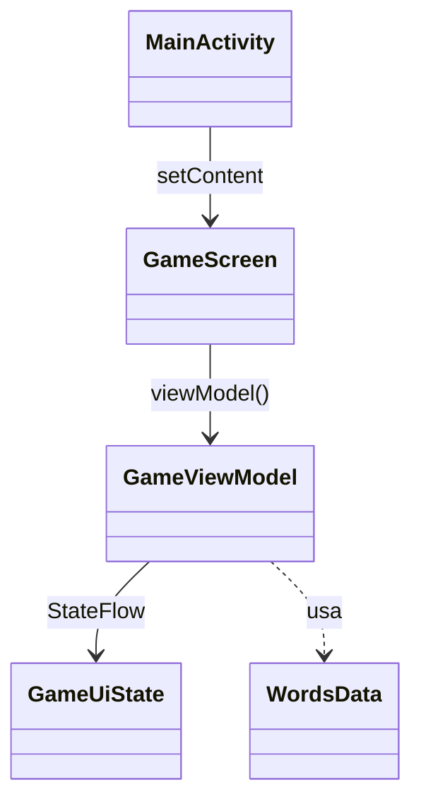

# UD02 · Kotlin y estructura de una app Android

> **Bloque MP0489_12 · Programación de dispositivos móviles.**
> Decisiones relacionadas: [DEC-PMDM-01](../../decisiones/DEC-PMDM-01-plataforma-y-lenguaje.md), [DEC-PMDM-09](../../decisiones/DEC-PMDM-09-contenidos-anadidos.md).

| Duración orientativa | RA trabajados |
|---|---|
| 14 h | RA1 (CE f, g) · RA2 (CE a, como introducción) |

## Criterios de evaluación

| CE | Texto (RD 405/2023) | Fuente | Cómo se evalúa |
|---|---|---|---|
| RA1.f | Se ha analizado la estructura de aplicaciones existentes para dispositivos móviles identificando las clases utilizadas. | RD 405/2023, anexo I, MP0489, RA1.f | P2, parte A (informe de análisis y diagrama de clases) |
| RA1.g | Se han realizado modificaciones sobre aplicaciones existentes. | RD 405/2023, anexo I, MP0489, RA1.g | P2, parte B (tres modificaciones y su instalación como actualización) |
| RA2.a | Se ha generado la estructura de clases necesaria para la aplicación. | RD 405/2023, anexo I, MP0489, RA2.a | Se trabaja aquí (paquetes y clases de modelo) y se evalúa en la UD04 (P4) |

## Objetivos de aprendizaje (propuesta del docente)

Al terminar la unidad el alumnado será capaz de:

1. Escribir código Kotlin idiomático partiendo de Java: nulabilidad, clases de datos, `when`, colecciones y lambdas.
2. Explicar la estructura de un proyecto Android: Gradle, manifiesto, recursos y código fuente.
3. Identificar los componentes de una app (Activity, Service, BroadcastReceiver, ContentProvider), las *intents* y la jerarquía de clases de `Context`.
4. Relacionar los estados de una Activity con los del BOE (activo, pausa, destruido) y conservar el estado de la interfaz ante rotaciones y la muerte del proceso.
5. Analizar una app existente, documentar sus clases y modificarla de forma controlada.

## Contenidos

### Contenidos básicos que cubre la unidad

> Bloques «Análisis de tecnologías para aplicaciones en dispositivos móviles» y «Desarrollo de aplicaciones para dispositivos móviles».

- Aplicaciones móviles. Estructura. Jerarquía de clases.
- Modelo de estados de una aplicación móvil: activo, pausa y destruido.
- Modificación de aplicaciones existentes.
- Herramientas. Flujo de trabajo.
- Componentes de una aplicación. Recursos.

### Desarrollo de los contenidos (propuesta del docente)

### 1. Kotlin para programadores Java (6 h)

Kotlin compila a *bytecode* de la JVM y DEX, y se puede usar junto a Java en el mismo proyecto. Estas son las diferencias que más se notan al venir de Java:

```kotlin
// Variables: val (inmutable) y var (mutable). El tipo se infiere.
val nombre = "Punto 1"          // String
var visitas = 0              // Int

// Nulabilidad en el sistema de tipos
var apodo: String? = null
val longitud = apodo?.length ?: 0      // llamada segura y operador Elvis
// apodo.length                        // no compila: hay que tratar el null

// Funciones de una expresión y parámetros con valor por defecto
fun saludo(quien: String = "mundo") = "Hola, $quien"

// Clase de datos: equals, hashCode, toString y copy generados
data class Observacion(
    val id: Long = 0,
    val titulo: String,
    val latitud: Double? = null,
    val longitud: Double? = null,
)

// Jerarquía cerrada: when exhaustivo, sin rama else
sealed interface Resultado<out T> {
    data class Exito<T>(val datos: T) : Resultado<T>
    data class Error(val mensaje: String) : Resultado<Nothing>
    data object Cargando : Resultado<Nothing>
}

fun describir(r: Resultado<List<Observacion>>): String = when (r) {
    is Resultado.Exito -> "${r.datos.size} observaciones"   // smart cast
    is Resultado.Error -> "Error: ${r.mensaje}"
    Resultado.Cargando -> "Cargando…"
}

// Colecciones y lambdas (equivalentes a los streams de Java)
val observaciones = listOf(
    Observacion(1, "Garza real", 42.23, -8.72),
    Observacion(2, "Punto de observación 2"),
)
val conUbicacion = observaciones
    .filter { it.latitud != null }
    .map { it.titulo.uppercase() }
    .sorted()

// Funciones de extensión
fun Observacion.tieneUbicacion() = latitud != null && longitud != null

// Funciones de ámbito
val copia = observaciones.first().copy(titulo = "Garza").also { println(it) }
```

**Corrutinas, primera aproximación.** Una función `suspend` puede pausarse sin bloquear el hilo. En Android, el hilo principal no debe bloquearse nunca, porque eso provoca un ANR.

```kotlin
suspend fun cargarDatos(): List<Observacion> {
    delay(1000)   // simula red: suspende, no bloquea
    return observaciones
}
```

Las corrutinas se ven en profundidad en la UD05. En MP0490 se trabajan hilos y concurrencia.

> **Alternativa:**
> - En **Flutter**, estas horas se dedican a **Dart**: `null safety`, `class`, `async`/`await`, `Future`/`Stream`.
> - En **React Native**, a **TypeScript**.
> - En **.NET MAUI**, a C#, que el alumnado verá también en Unity.

### 2. Estructura de un proyecto y flujo de trabajo

```
settings.gradle.kts         → rootProject.name, include(":app"), repositorios
gradle/libs.versions.toml   → catálogo de versiones: [versions], [libraries], [plugins]
app/build.gradle.kts        → plugins, android { … }, dependencies { … }
app/src/main/AndroidManifest.xml
app/src/main/java/…         → código Kotlin (la carpeta se llama java por herencia)
app/src/main/res/           → recursos: values/strings.xml, drawable/, mipmap/, values-gl/
app/src/test/               → pruebas unitarias (JVM)
app/src/androidTest/        → pruebas instrumentadas (dispositivo o emulador)
```

```kotlin
// app/build.gradle.kts (fragmento)
plugins {
    alias(libs.plugins.android.application)
    alias(libs.plugins.kotlin.android)   // en AGP 9 Kotlin viene integrado y este plugin puede no aparecer
    alias(libs.plugins.kotlin.compose)   // compilador de Compose (Kotlin 2.x)
}

dependencies {
    implementation(platform(libs.androidx.compose.bom)) // la BOM alinea las versiones de Compose
    implementation(libs.androidx.activity.compose)
    implementation(libs.androidx.material3)
    debugImplementation(libs.androidx.ui.tooling)
}
```

**Recursos y la clase `R`.** Cada recurso genera un identificador (`R.string.app_name`, `R.drawable.logo`). Los calificadores permiten elegir la variante del recurso según el dispositivo:

- Idioma: `values-es/`, `values-gl/`. Encaja con el contexto gallego del centro.
- Modo oscuro: `values-night/`.
- Densidad: `drawable-xxhdpi/`.

En Compose se accede a ellos así:

```kotlin
Text(text = stringResource(R.string.titulo_lista))
Image(painter = painterResource(R.drawable.logo), contentDescription = null)
```

**Flujo de trabajo:**

1. Editar el código.
2. Compilar con Gradle (`assembleDebug`).
3. Instalar y ejecutar (el botón ▶ o `adb install`).
4. Depurar con Logcat, los puntos de ruptura y el Layout Inspector.
5. Hacer *commit* en Git.

Variantes de compilación: `debug` (firmada con la clave de depuración) y `release` (se ve en la UD06).

### 3. Componentes de una aplicación y jerarquía de clases

| Componente | Para qué sirve | Se declara en el manifiesto |
|---|---|---|
| `Activity` | Una pantalla o ventana con la que interactúa el usuario. Con Compose suele haber una sola (`ComponentActivity`) | `<activity>` |
| `Service` | Trabajo sin interfaz: reproducción, sincronización en primer plano… | `<service>` |
| `BroadcastReceiver` | Responde a eventos del sistema o de otras apps (batería baja, arranque…) | `<receiver>` o registro en código |
| `ContentProvider` | Expone datos a otras apps (contactos, galería) mediante URIs `content://` | `<provider>` |

Los componentes se comunican con **intents**. Las explícitas indican la clase; las implícitas indican una acción.

```kotlin
// Implícita: abrir una web con la app que el usuario elija
context.startActivity(Intent(Intent.ACTION_VIEW, "https://developer.android.com".toUri()))

// Compartir texto
val enviar = Intent(Intent.ACTION_SEND).apply {
    type = "text/plain"
    putExtra(Intent.EXTRA_TEXT, "He visto una garza real en el Lagares")
}
context.startActivity(Intent.createChooser(enviar, null))
```

**Jerarquía de clases** (se puede ver en Android Studio con *Navigate › Type Hierarchy*):

```
Context (abstracta)
└─ ContextWrapper
   ├─ Application              un objeto por proceso
   ├─ Service
   └─ ContextThemeWrapper
      └─ Activity
         └─ ComponentActivity  base para Compose (setContent, Activity Result APIs)
            └─ FragmentActivity
               └─ AppCompatActivity   apps con Vistas XML y Fragments
```

En las apps con Vistas XML (código antiguo), la interfaz es un árbol de `View` y `ViewGroup` (`LinearLayout`, `ConstraintLayout`…). En Compose, la interfaz es un árbol de funciones `@Composable`.

### 4. Modelo de estados y ciclo de vida de la Activity

Los tres estados del BOE corresponden a los estados y *callbacks* de Android así:

| Estado del BOE | Estado de Android | *Callbacks* de entrada y salida | Qué hacer |
|---|---|---|---|
| (creación) | *Created* | `onCreate()` | Llamar a `setContent { }` e inicializar lo que dura toda la Activity |
| **Activo** | *Resumed* (en primer plano, con el foco) | `onStart()` → `onResume()` | Iniciar la cámara, los sensores o las animaciones |
| **Pausa** | *Started*/*Paused* (visible, pero sin el foco: diálogo del sistema, multiventana) y *Stopped* (no visible) | `onPause()` → `onStop()` | Liberar los sensores y la cámara y guardar los cambios |
| **Destruido** | *Destroyed* | `onDestroy()` | Lo provoca `finish()`, un cambio de configuración (rotación) o que el sistema libere memoria |

```kotlin
private const val TAG = "Ciclo"

class MainActivity : ComponentActivity() {
    override fun onCreate(savedInstanceState: Bundle?) {
        super.onCreate(savedInstanceState)
        enableEdgeToEdge()
        Log.d(TAG, "onCreate (¿hay estado guardado? ${savedInstanceState != null})")
        setContent { CuadernoTheme { Contador() } }
    }
    override fun onStart()   { super.onStart();   Log.d(TAG, "onStart") }
    override fun onResume()  { super.onResume();  Log.d(TAG, "onResume → activo") }
    override fun onPause()   { super.onPause();   Log.d(TAG, "onPause → pausa") }
    override fun onStop()    { super.onStop();    Log.d(TAG, "onStop") }
    override fun onDestroy() { super.onDestroy(); Log.d(TAG, "onDestroy → destruido") }
}

@Composable
fun Contador() {
    var a by remember { mutableIntStateOf(0) }          // se pierde al rotar
    var b by rememberSaveable { mutableIntStateOf(0) }  // sobrevive a la rotación y a la muerte del proceso
    Column(Modifier.safeDrawingPadding().padding(16.dp)) {
        Button(onClick = { a++; b++ }) { Text("Sumar") }
        Text("remember: $a · rememberSaveable: $b")
    }
}
```

También se puede reaccionar al ciclo de vida desde Compose:

```kotlin
LifecycleEventEffect(Lifecycle.Event.ON_PAUSE) { Log.d(TAG, "Composable: la app pasa a pausa") }
```

`LifecycleEventEffect` está en el artefacto `androidx.lifecycle:lifecycle-runtime-compose`.

**Prueba en clase:**

1. Rotar el emulador: se ve `onPause`, `onStop`, `onDestroy`, `onCreate`…
2. Pulsar Inicio: la app queda detenida pero no destruida.
3. Matar el proceso en segundo plano con `adb shell am kill es.fpdam.observaciones` o con *Terminate app* en Logcat y volver a la app: el estado de `rememberSaveable` sigue ahí.

### 5. Analizar una app existente (RA1.f)

Se sigue este método:

1. **Leer el manifiesto:** componentes, permisos, `uses-feature`, Activity de entrada.
2. **Leer las dependencias** de `build.gradle.kts`: qué librerías usa y para qué.
3. **Ver el árbol de paquetes** (vista *Project*): `ui/`, `data/`, `model/`…
4. **Identificar las clases y sus relaciones:** Activity, ViewModel, estado de la interfaz, repositorios, entidades. Para generar el diagrama se pueden usar *Type Hierarchy* o *Call Hierarchy*, o escribirlo a mano en Mermaid.
5. **Ejecutar con el Layout Inspector** para relacionar cada elemento de la pantalla con su `@Composable`.

Ejemplo de diagrama en Mermaid, que GitHub y MkDocs pueden mostrar como gráfico:



La app de referencia es **Unscramble**, el codelab oficial de ViewModel y estado en Compose ([repositorio de Google Developer Training](https://github.com/google-developer-training/basic-android-kotlin-compose-training-unscramble), licencia Apache-2.0).

### 6. Modificar una app existente (RA1.g)

Buenas prácticas:

- Crear una rama de Git antes de tocar nada.
- Hacer cambios pequeños, compilar y probar después de cada uno.
- No romper el contrato existente.
- Subir `versionCode` e instalar como **actualización** (`adb install -r`) para comprobar que los datos se conservan.

Ejemplos de modificaciones que se proponen:

- Traducir la app al gallego: añadir `res/values-gl/strings.xml` y probarla con el idioma del sistema en gallego, o con `adb shell cmd locale` según la versión.
- Cambiar una regla de negocio en el ViewModel, por ejemplo la puntuación o el número de palabras.
- Añadir un control nuevo a la interfaz, por ejemplo un botón de pista, siguiendo el flujo unidireccional existente.
- Cambiar el tema (colores de Material 3) en `ui/theme/`.

## Actividades (propuesta del docente)

### Actividades de clase (no evaluables)

- **A1. Kotlin Koans.** Ejercicios seleccionados en [Kotlin Playground](https://play.kotlinlang.org/koans/overview): *Introduction*, *Classes*, *Collections*.
- **A2. De Java a Kotlin.** Convertir una clase Java de 1.º con *Code › Convert Java File to Kotlin File* y hacer idiomático el resultado: `data class`, `val`, nulabilidad.
- **A3. Laboratorio de ciclo de vida.** Con el código de la sección 4, documentar en una tabla la secuencia de *callbacks* en cinco situaciones: abrir, rotar, Inicio, volver, cerrar con Atrás.
- **A4. Intents.** Pantalla con tres botones: abrir una web, compartir texto y marcar un teléfono (`ACTION_DIAL`, sin permiso).
- **A5. Jerarquía de clases.** Con *Type Hierarchy*, dibujar la cadena desde `Context` hasta `ComponentActivity` y explicar qué aporta cada nivel.

### Práctica evaluable

**P2 · Análisis y modificación de una app existente.** Es individual. Sobre Unscramble, o sobre otra app de código abierto que proponga el profesorado:

> **Conexión con el mundo real:** al incorporarse a una empresa, lo habitual es empezar manteniendo código ajeno: entender la estructura, localizar dónde tocar y entregar cambios pequeños y revisables sin romper nada.


- **Parte A, análisis (RA1.f):** informe de 2-3 páginas con:
  - los componentes del manifiesto;
  - las dependencias y su función;
  - el diagrama de clases (Mermaid) con la responsabilidad de cada clase;
  - el flujo de datos desde que se pulsa un botón hasta que se actualiza la pantalla.
- **Parte B, modificación (RA1.g):** tres modificaciones:
  1. traducción al gallego;
  2. un cambio de lógica;
  3. un control nuevo en la interfaz.

  Cada una va en un *commit* propio con un mensaje descriptivo. Después se sube `versionCode`, se instala como actualización y se entrega una captura de `adb shell dumpsys package <paquete> | grep versionCode`.
- **Entregables:** repositorio con una rama `p2`, `README.md` con el informe y las capturas, y el APK de *debug*.

| CE | Excelente (10-9) | Adecuado (8-5) | Insuficiente (<5) |
|---|---|---|---|
| RA1.f | Identifica todas las clases y su capa. El diagrama es correcto y explica el flujo de datos y el papel del ciclo de vida | Identifica las clases principales y el diagrama es parcialmente correcto | Lista ficheros sin explicar su papel, o el diagrama es incorrecto |
| RA1.g | Hace tres modificaciones bien aisladas, sin regresiones, con *commits* limpios. La actualización conserva los datos | Hace tres modificaciones con algún fallo menor, o la actualización no está bien documentada | Hace menos de tres modificaciones, la app no compila o se pierde la funcionalidad original |

## Recursos

- **Documentación oficial:**
  - [Kotlin para desarrolladores Java](https://kotlinlang.org/docs/java-to-kotlin-idioms-strings.html)
  - [Conceptos básicos de las apps](https://developer.android.com/guide/components/fundamentals)
  - [Ciclo de vida de la Activity](https://developer.android.com/guide/components/activities/activity-lifecycle)
  - [Guardar estados de la interfaz](https://developer.android.com/topic/libraries/architecture/saving-states)
  - [Intents y filtros de intents](https://developer.android.com/guide/components/intents-filters)
  - [Proveer recursos alternativos](https://developer.android.com/guide/topics/resources/providing-resources)
  - [Layout Inspector](https://developer.android.com/studio/debug/layout-inspector)
- **Codelabs:** [Etapas del ciclo de vida de la actividad](https://developer.android.com/codelabs/basic-android-kotlin-compose-activity-lifecycle) · [ViewModel y estado en Compose (Unscramble)](https://developer.android.com/codelabs/basic-android-kotlin-compose-viewmodel-and-state)
- **Herramientas:** Android Studio (Logcat, Layout Inspector, Type Hierarchy), Kotlin Playground, Git.
