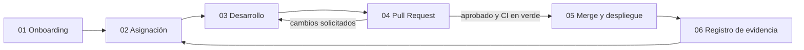

# Flujo de trabajo

> Componente de [FP·onboard](https://fponboard.github.io/) (§3 Diseño), iniciativa del autor de este repositorio. Forma parte de la [propuesta FP·onboard](README.md), complementaria a la programación de los módulos.

## Ciclo de trabajo en seis fases

| Fase | Nombre | Qué ocurre |
|---|---|---|
| 01 | **Onboarding** | Alta en el repositorio, configuración del entorno local y familiarización con la arquitectura del proyecto base |
| 02 | **Asignación** | Selección de una unidad de trabajo (*issue*) del backlog, acorde al nivel y al itinerario |
| 03 | **Desarrollo** | Código en rama propia, con commits incrementales, pruebas locales y buenas prácticas de estilo |
| 04 | **Pull Request** | Apertura formal de la propuesta de cambio, revisión por pares y paso de los controles automáticos de calidad |
| 05 | **Merge y despliegue** | Integración en la rama principal y publicación automatizada en un entorno de previsualización |
| 06 | **Registro de evidencia** | Consolidación de los indicadores del ciclo en la [Matriz de Capacidad](matriz-de-capacidad.md) individual |

## Organización de equipos

- Cada proyecto se divide en **3-4 componentes paralelos**, asumidos por subequipos de 5-7 personas que trabajan sobre **un mismo código base**.
- Con grupos de 10 personas o menos: 2 subequipos de 4-5 personas sobre 2-3 componentes.
- Herramientas: GitHub Organization (control de versiones y colaboración), GitHub Actions (pruebas y despliegue automáticos), Docker (entornos reproducibles).

